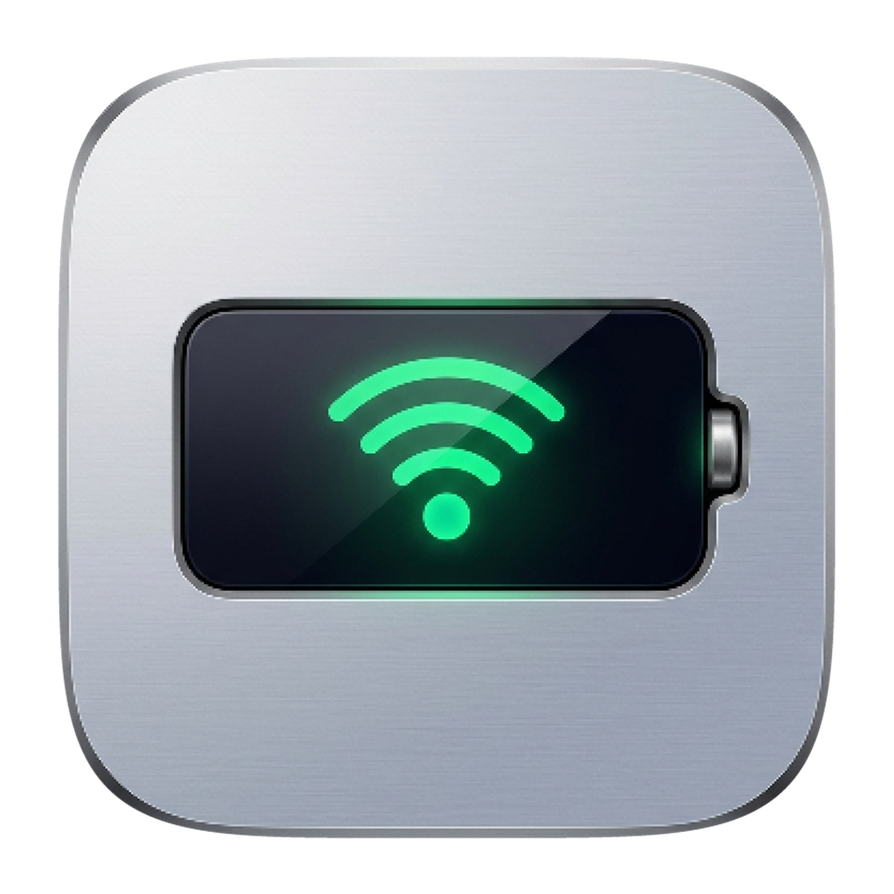
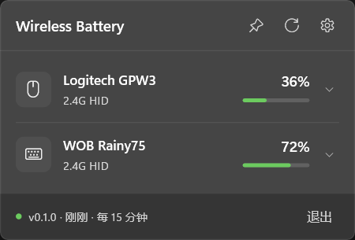
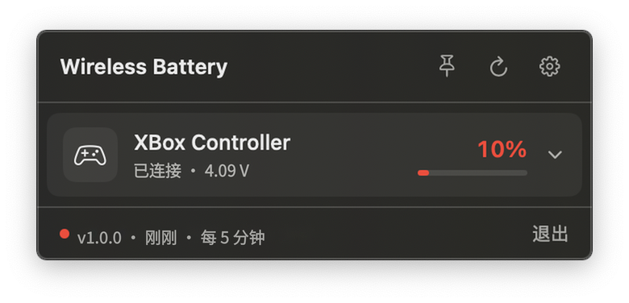
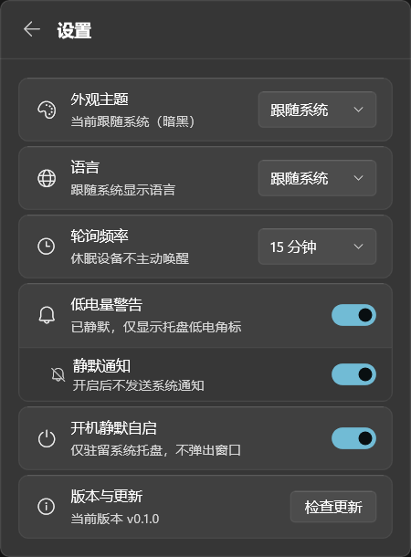
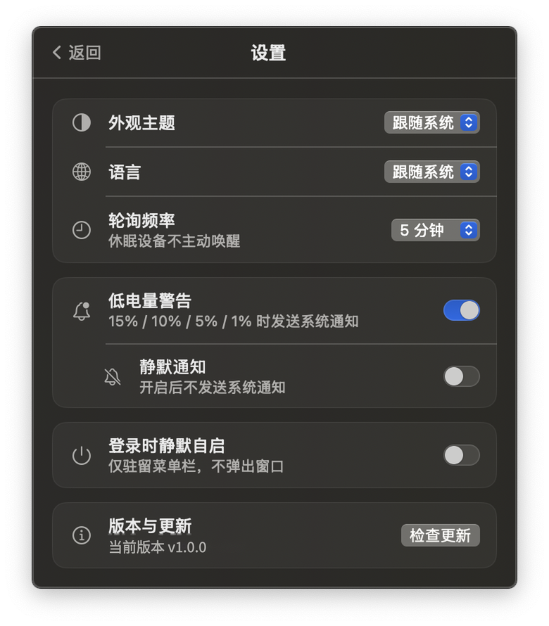

<div align="center">
  
  <h1>Wireless Battery</h1>
</div>

> **Language / 语言**: **English** | [简体中文](README.zh-CN.md)

A synchronous Rust library and CLI for conservative peripheral battery readings over HID, with built-in read-only Bluetooth LE Battery Service (BAS) support.

## Features

- **Broad device support**: **165 built-in providers** (163 vendor HID providers plus `os.xinput` and `bluetooth.bas`) cover mice, keyboards, headsets, gamepads, and other wireless peripherals. See the [support matrix](docs/support-matrix.md) for the complete device and model list.
- **Multiple deliverables**: **Tray, CLI, and Rust API** deliverables support desktop use, script automation, and third-party application integration.
- **Native tray experience**: Tray is available on **macOS and Windows**, using SwiftUI and Win32 / Direct2D respectively to follow each platform's native UI conventions.
- **Evidence-based device support**: Device support is based primarily on real-device reverse engineering and device implementations from other open-source projects; see [NOTICE](NOTICE) for background and attribution.

## Build

Rust 1.76 or newer is supported. `Cargo.lock` pins dependency versions to preserve that MSRV (`--locked`). Both `cli` and `bluetooth` features are enabled by default; library consumers can disable default features with `--no-default-features` to avoid compiling CLI (`clap`) and BLE (`btleplug`, `tokio`, `uuid`) dependencies, or enable only `--features cli` / `--features bluetooth`.

```bash
cargo build --locked
cargo build --locked --no-default-features
cargo test --locked --all-features
cargo clippy --locked --all-targets --all-features -- -D warnings
```

See [platform support](docs/platform-support.md) for system dependencies and permission limitations.

## Deliverables

### Tray

An independent Cargo workspace under [`tray/`](tray/README.md) provides a native desktop system tray application built on a shared Rust core (`tray-core`) with thin OS-native shells (Win32 + DWM Acrylic + Direct2D on Windows; AppKit `NSStatusItem` with a SwiftUI popover via `tray-ffi` on macOS). Keeping it in a separate workspace prevents GUI dependencies from polluting the core library or CLI.

<p align="center"><strong>Devices</strong></p>
<table align="center" border="0" cellpadding="0" cellspacing="0">
  <tr>
    <td align="center" valign="top" width="380"></td>
    <td align="center" valign="top" width="380"></td>
  </tr>
  <tr>
    <td align="center"><strong>Windows</strong></td>
    <td align="center"><strong>macOS</strong></td>
  </tr>
</table>

<p align="center"><strong>Settings</strong></p>
<table align="center" border="0" cellpadding="0" cellspacing="0">
  <tr>
    <td align="center" valign="top" width="380"></td>
    <td align="center" valign="top" width="380"></td>
  </tr>
  <tr>
    <td align="center"><strong>Windows</strong></td>
    <td align="center"><strong>macOS</strong></td>
  </tr>
</table>

```bash
cd tray
cargo test --locked
cargo build --locked --release -p wireless-battery-tray   # Windows native tray
```

See the [Tray README](tray/README.md) for architecture, macOS bundling, and BLE support details.

### CLI

```bash
wireless-battery list --json
wireless-battery list --read
wireless-battery list --read --json --timeout-ms 5000
wireless-battery read <device-id> --json --timeout-ms 1000
wireless-battery diagnose <device-id> --json
wireless-battery probe <device-id> --listen 3000
wireless-battery probe <device-id> --report-id 0 --send "5A A5 01 02 00"
```

All built-in vendor and OS providers are enabled by default. `list` includes every enumerated endpoint, including unmatched and ambiguous ones. Default `list` remains passive and displays battery as `not read`; `list --read` explicitly queries only currently readable devices. Its JSON entries contain the original device fields plus `reading` and `read_error`; one device failure does not fail the whole list. JSON is written only to stdout; warnings and progress go to stderr.

For unsupported HID endpoints, use `probe` to passively listen (`--listen`) or send raw Output/Feature reports (`--send`, `--send-feature`, `--get-feature`, `--get-input`) for reverse engineering.

Device IDs are opaque hashes, not serial numbers. They are intended for session-local use. On platforms where the OS path is stable, they are also deterministic enough for a later CLI `read` invocation, but persistence across reboots, machines, or path reassignment is not guaranteed.

Exit codes: 0 success; 2 arguments; 3 absent/unsupported; 4 permission; 5 timeout/transport; 6 response validation; 70 internal error.

### Rust API

```rust
use wireless_battery::{BatteryClient, ClientConfig};

let client = BatteryClient::new(ClientConfig::default())?;
let devices = client.list_devices()?;
for device in &devices {
    println!("{}: {} ({:?})", device.id, device.name, device.match_status);
}

if let Some(device) = devices.iter().find(|device| device.readable) {
    let reading = client.read_battery(&device.id.0)?;
    println!("{:?}% ({:?})", reading.percentage, reading.freshness);
}
# Ok::<(), wireless_battery::BatteryError>(())
```

All registered providers can be read by default. A stale value is returned only when caching is enabled and the caller explicitly sets `ReadOptions::allow_stale`; its original `observed_at` is preserved and `freshness` becomes `stale`.

`ReadOptions::timeout` is the total call budget. A provider's `io_timeout` is a separate per-I/O preference, capped by the remaining total budget. Some platform feature operations cannot be forcibly cancelled.

## Unsupported Devices

If your device shows up as `unmatched` or reports `null` / `unknown` battery readings, try these 3 steps:

1. **Check the Connection Mode & Endpoints**
   - Run `wireless-battery list --json` to inspect all enumerated endpoints.
   - Many multi-mode peripherals and gamepads (e.g., Flydigi, 8BitDo) expose only a Windows-reserved XInput endpoint (`045E:028E`) in XInput mode, and most third-party controllers do not report battery over XInput. Switch to **2.4G dongle, wired, DInput / vendor mode**, or **BLE mode** (standard BAS `0x2A19` works directly), then re-run `list` to check for a vendor HID endpoint (`usage_page >= 0xFF00`).

2. **Probe Raw Packets with `probe` (and Bidirectional Capture if Needed)**
   - Passively listen for unsolicited reports (or shared HID replies while the vendor app is open): `wireless-battery probe <device-id> --listen 5000` (plug/unplug the cable or interact with the device).
   - If the device requires host-initiated queries and has no known protocol match, capture **both Host → Device requests and Device → Host responses** via **Wireshark + USBPcap** / `usbmon` (or WebHID) along with the ground-truth percentage/charge state, then **close the vendor app** and verify independently with `probe`:
     `wireless-battery probe <device-id> --report-id 0 --send "5A A5 ..."` (or `--set-output`, `--send-feature`, `--get-feature 0x03`), comparing raw bytes between **discharging** and **charging** states.

3. **Open an Issue or PR**
   - **Issue**: Share your device model, connection mode, `wireless-battery list --json` output, and paired request/response `probe` packets for discharging/charging states (verified with the vendor app closed).
   - **PR**: Add a `FixedSpec` or `Provider` under `src/providers/vendors/{protocols,brands}/` with `DeviceKind` set accurately, add replay tests, update `docs/support-matrix*.md`, and verify with `cargo test --locked --all-features`.

### Copy-Paste Prompt for an AI Agent

You can paste the following prompt directly into an AI coding agent (such as Antigravity, Claude Code, Cursor, or Codex) to inspect connected devices, probe raw HID packets, and integrate support if you are inside the source repository:

```text
Help me inspect my connected wireless peripherals and reverse-engineer unsupported devices using the wireless-battery CLI.

Project repository: https://github.com/bangbang0103/wireless-battery
Use this repository for source code, documentation, and Releases; do not search the web to identify the project.

Follow these steps in order:
0. **Prepare the CLI Binary**:
   - Check if `wireless-battery` / `wireless-battery.exe` is available in the current directory or PATH (or use `cargo run --locked --` if we are inside the source repository). If not, guide me to download the prebuilt binary for my OS from Releases.

1. **Enumerate, Check Modes & Select Safe Candidate Endpoints**:
   - Run `wireless-battery list --json` and `wireless-battery list --read --json`, and summarize every detected device (name, VID/PID, `usage_page`, `usage`, `interface_number`, `match_status`, `provider_id`, battery percentage, and charge state).
   - If the target device only exposes a Windows-reserved standard endpoint (e.g., XInput `045E:028E`, `usage_page=1, usage=5`), guide me to switch connection modes (2.4G dongle / wired / DInput vendor mode / BLE) and re-run `list --json`.
   - If multiple vendor HID endpoints (`usage_page >= 0xFF00`) are present, list all of them and filter carefully: avoid obvious configuration/firmware channels (such as VIA `FF60:0061`) and never send blind write commands to unknown channels.

2. **Tiered Reverse-Engineering & Bidirectional Verification**:
   - **2a. Check Existing Clues & Passive/Shared Listening**: Search `src/providers/vendors/` (if in the repo) and open-source references for known query protocols sharing the same VID/PID, brand, or chipset. Meanwhile, run `wireless-battery probe <device-id> --listen 5000` (while plugging/unplugging the cable, waking the device, or refreshing battery in the vendor app/WebHID configurator to listen on the shared HID handle).
   - **2b. Bidirectional Capture (when no clue works and `--listen` yields no battery reply)**: Guide me to use **Wireshark + USBPcap (Windows) / `usbmon` (Linux)** (or browser WebHID DevTools) to capture **both Host → Device (sent) and Device → Host (received)** packets while reading battery, and record the **ground-truth percentage and charging state** shown by the vendor software/device indicator (ideally covering discharging, charging, and two different percentage levels). If I provide a `.pcapng` or capture log, extract paired request/response frames, handshakes, and changing bytes.
   - **2c. `probe` Testing & Independent Verification (avoid false positives)**:
     - Map candidate or captured commands to `probe` (distinguish `--send` vs `--send --set-output`, and `--send-feature` / `--get-feature` / `--get-input`; keep `--report-id` separate from the hex payload; use `--read-replies` to read multiple packets and skip heartbeats or command echoes). Note that a successful OS write does not mean the device accepted the command.
     - Once a working query is found, **fully quit the vendor app / WebHID tab**, wake the device, and independently reproduce consistent replies in both **discharging** and **charging** states with `probe` (never guess percentages from arbitrary bytes; voltage curves or discrete step scales must follow an explicit, model-specific rule, and unverified charge states and unknown sentinels must stay `unknown`).

3. **Next Steps**:
   - If only the prebuilt binary is available (no source repo): format a clean summary with device model, connection mode, `list --json` endpoint metadata, and paired discharging/charging `probe` request/response hex (verified with the vendor app closed) plus ground-truth percentage/state so I can open a GitHub Issue.
   - If we are inside the cloned source repository: read `docs/contributing-device.md` and `docs/capture-and-replay.md` first, implement a `FixedSpec` or `Provider` under `src/providers/vendors/{protocols,brands}/`, add replay fixtures under `tests/fixtures/vendors/` and `tests/extended_vendor/`, update `docs/support-matrix.md` and `docs/support-matrix.zh-CN.md`, and verify everything passes with `cargo test --locked --all-features`.
```

## Documentation

- [Architecture](docs/architecture.md)
- [Support matrix](docs/support-matrix.md)
- [Platform support](docs/platform-support.md)
- [Capture and replay](docs/capture-and-replay.md)
- [Contributing a device](docs/contributing-device.md)
- [Native system tray](tray/README.md)

## Contributing

Start with [device contributions](docs/contributing-device.md). Simple fixed protocols should use `FixedSpec`; dynamic negotiation belongs in a focused `Provider` under `src/providers/vendors/{protocols,brands}/`.

## Community

- **QQ Group**: `1137618759`
- **Discord**: [Join Discord](https://discord.gg/Dd4vJeaD3g)

Licensed under the [GNU General Public License v3.0 or later](LICENSE).
