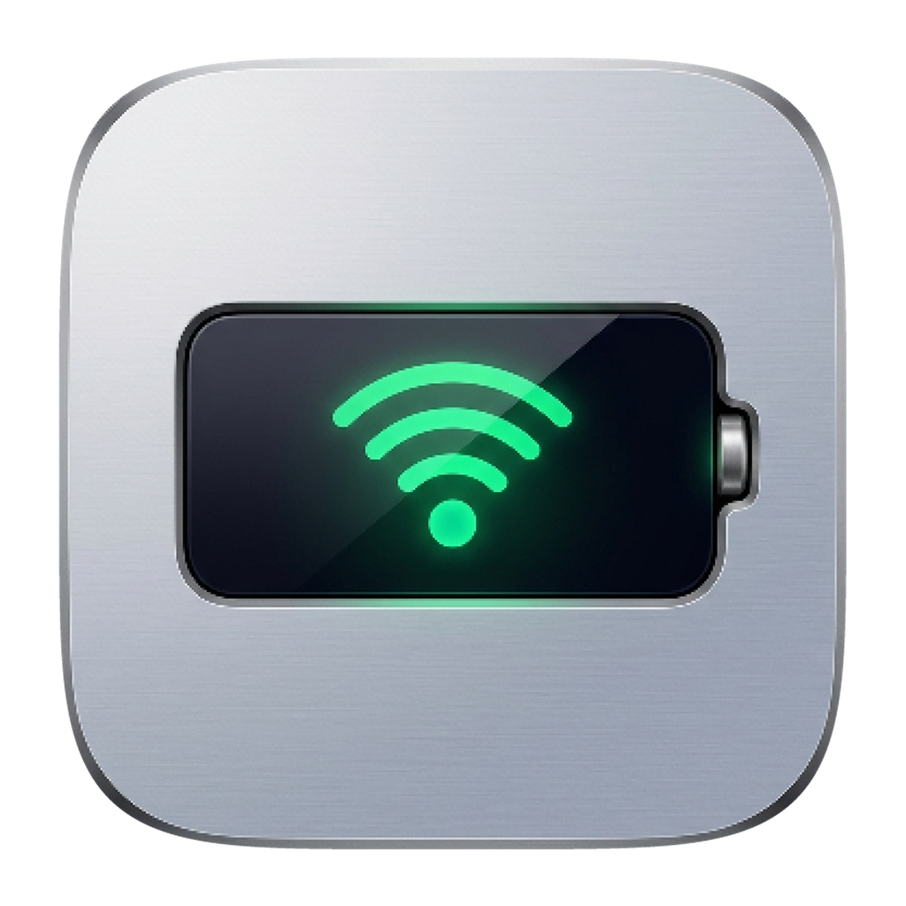
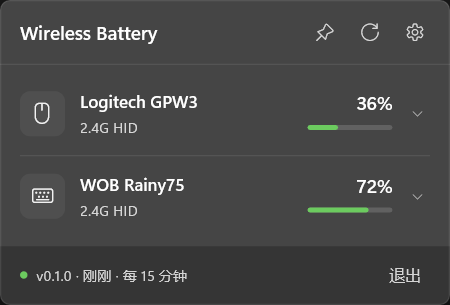
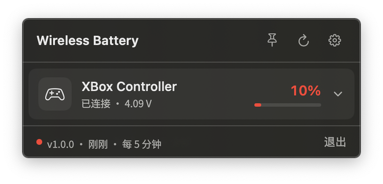
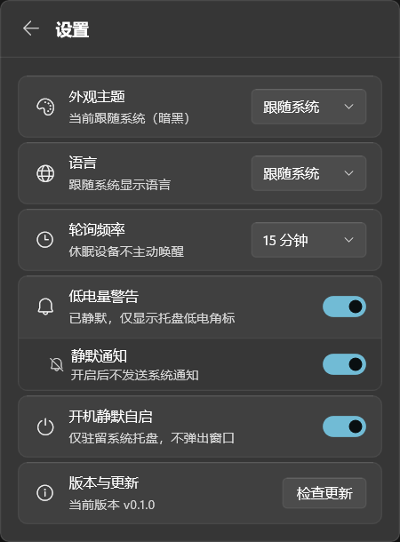
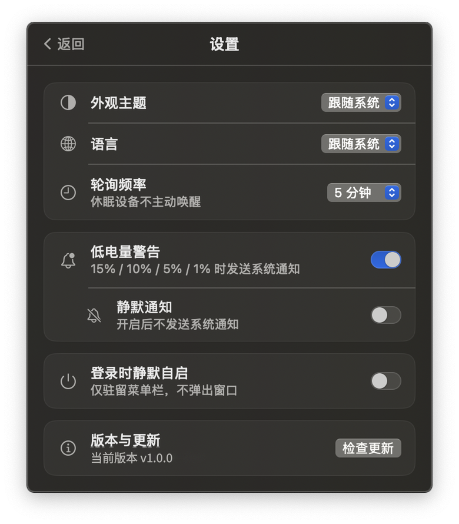

<div align="center">
  
  <h1>Wireless Battery</h1>
</div>

> **Language / 语言**: [English](README.md) | **简体中文**

一个同步 Rust 库与命令行工具，用于通过 HID 稳妥、非侵入式地读取外设电量，并默认支持只读 Bluetooth LE Battery Service（BAS）。

## 功能特性

- **广泛的设备支持**：目前内置 **153 个 Provider**（151 个厂商 HID Provider，以及 `os.xinput` 和 `bluetooth.bas`），覆盖鼠标、键盘、耳机、手柄等无线外设。完整设备与型号列表见[设备支持矩阵](docs/support-matrix.zh-CN.md)。
- **多种交付形态**：提供 **Tray、CLI 与 Rust API**，分别满足桌面交互、脚本自动化与第三方应用集成需求。
- **原生托盘体验**：Tray 支持 **macOS 与 Windows**，分别采用 SwiftUI 与 Win32 / Direct2D，界面风格与系统原生 UI 保持一致。
- **有据可依的设备支持**：设备支持主要来自真实设备逆向，并参考了其他开源项目的实现；相关说明与署名见 [NOTICE](NOTICE)。

## 构建

支持 Rust 1.76 及以上版本。`Cargo.lock` 锁定依赖版本以维持 MSRV（`--locked`）。`cli` 与 `bluetooth` feature 默认均已开启；仅作为库引入的项目可通过 `--no-default-features` 关闭默认特性，避免编译 CLI（`clap`）与 BLE（`btleplug`、`tokio`、`uuid`）依赖，也可按需单独开启 `--features cli` 或 `--features bluetooth`。

```bash
cargo build --locked
cargo build --locked --no-default-features
cargo test --locked --all-features
cargo clippy --locked --all-targets --all-features -- -D warnings
```

系统依赖与权限限制详见[平台支持](docs/platform-support.zh-CN.md)。

## 交付产物

### Tray（原生系统托盘）

[`tray/`](tray/README.zh-CN.md) 是一个独立于根库与 CLI 的 Cargo 工作区，采用 **共享 Rust 核心（`tray-core`） + 各平台极薄原生 UI 壳** 架构（Windows 为 Win32 + DWM Acrylic + Direct2D；macOS 为 AppKit `NSStatusItem` + SwiftUI 弹层 + `tray-ffi` 静态库），避免 GUI 依赖污染核心库与 CLI。

<p align="center"><strong>设备列表</strong></p>
<table align="center" border="0" cellpadding="0" cellspacing="0">
  <tr>
    <td align="center" valign="top" width="380"></td>
    <td align="center" valign="top" width="380"></td>
  </tr>
  <tr>
    <td align="center"><strong>Windows</strong></td>
    <td align="center"><strong>macOS</strong></td>
  </tr>
</table>

<p align="center"><strong>设置页</strong></p>
<table align="center" border="0" cellpadding="0" cellspacing="0">
  <tr>
    <td align="center" valign="top" width="380"></td>
    <td align="center" valign="top" width="380"></td>
  </tr>
  <tr>
    <td align="center"><strong>Windows</strong></td>
    <td align="center"><strong>macOS</strong></td>
  </tr>
</table>

```bash
cd tray
cargo test --locked
cargo build --locked --release -p wireless-battery-tray   # Windows 原生托盘
```

架构细节、macOS `.app` 打包及 BLE 支持说明详见 [托盘说明文档](tray/README.zh-CN.md)。

### CLI（命令行）

```bash
wireless-battery list --json
wireless-battery list --read
wireless-battery list --read --json --timeout-ms 5000
wireless-battery read <device-id> --json --timeout-ms 1000
wireless-battery diagnose <device-id> --json
wireless-battery probe <device-id> --listen 3000
wireless-battery probe <device-id> --report-id 0 --send "5A A5 01 02 00"
```

所有已内置的厂商与系统 Provider 默认均已启用，无需额外开关。`list` 会返回所有枚举到的端点（含未匹配与冲突端点）。默认 `list` 保持完全被动，电量显示为 `not read`；`list --read` 仅显式读取当前可读的设备，其 JSON 条目在原始设备字段基础上附加 `reading` 与 `read_error`，单个设备失败不会导致整个列表失败。JSON 仅输出到 stdout，警告与进度信息输出到 stderr。

对于未支持的 HID 设备，可以直接使用 `probe` 对任意端点进行被动监听（`--listen`）或发送自定义 Output / Feature 报文（`--send`、`--send-feature`、`--get-feature`、`--get-input`）以辅助逆向分析。

设备 ID 是不可逆哈希值而非序列号，主要面向单次会话使用。在操作系统路径稳定的平台上，其确定性足以支持后续 `read` 命令调用，但不保证跨重启、跨机器或路径重分配后保持不变。

退出码约定：`0` 成功；`2` 参数错误；`3` 设备不存在或不支持；`4` 权限不足；`5` 超时或传输错误；`6` 响应校验失败；`70` 内部错误。

### Rust API

```rust
use wireless_battery::{BatteryClient, ClientConfig};

let client = BatteryClient::new(ClientConfig::default())?;
let devices = client.list_devices()?;
for device in &devices {
    println!("{}: {} ({:?})", device.id, device.name, device.match_status);
}

if let Some(device) = devices.iter().find(|device| device.readable) {
    let reading = client.read_battery(&device.id.0)?;
    println!("{:?}% ({:?})", reading.percentage, reading.freshness);
}
# Ok::<(), wireless_battery::BatteryError>(())
```

所有已注册 Provider 默认可直接读取。只有在启用缓存且调用方显式设置 `ReadOptions::allow_stale` 时，刷新失败才会返回缓存的旧值；旧值保留原始 `observed_at` 时间戳，并将 `freshness` 标记为 `stale`。

`ReadOptions::timeout` 是整次调用的总时间预算。Provider 中的 `io_timeout` 是单次 I/O 偏好值，受限于剩余总预算。部分平台的 Feature 报告操作无法被强制取消。

## 未支持的设备怎么办

如果设备显示为 `unmatched` 或电量读取为 `null` / `unknown`，可按以下 3 步处理：

1. **先确认连接模式与端点**
   - 运行 `wireless-battery list --json` 查看所有端点。
   - 不少多模外设或手柄（如飞智、八位堂等）在纯 **XInput 模式**（`045E:028E`）下会被 Windows 保留，且多数第三方手柄不通过 XInput 上报电量；尝试切换至 **2.4G 接收器、有线、DInput / 厂商模式** 或 **BLE 模式**（支持标准 BAS `0x2A19` 可直接读取），再重新 `list` 确认是否出现厂商自定义 HID 端点（通常 `usage_page >= 0xFF00`）。

2. **用 `probe` 探测报文（必要时结合双向抓包）**
   - 监听设备主动上报（或在官方软件运行时通过共享 HID 句柄监听回复）：`wireless-battery probe <device-id> --listen 5000`（插拔充电线或操作设备观察变化）。
   - 若设备需要主机先发查询且暂无已知协议，使用 **Wireshark + USBPcap** / `usbmon`（或 WebHID）**同时捕获 Host → Device（发出）与 Device → Host（返回）的双向报文**并记录实际电量，然后**关闭官方软件**用 `probe` 独立验证：
     `wireless-battery probe <device-id> --report-id 0 --send "5A A5 ..."`（或 `--set-output`、`--send-feature`、`--get-feature 0x03`），对比**放电**与**充电**状态下的原始字节。

3. **提交 Issue 或 PR**
   - **提 Issue**：附上设备型号、连接模式、`wireless-battery list --json` 输出，以及关闭官方软件后 `probe` 验证到的放电/充电配对请求与响应报文。
   - **提 PR**：在 `src/providers/vendors/{protocols,brands}/` 中参考现有 `FixedSpec` 或 `Provider` 实现新增协议并标注准确的 `DeviceKind`，补充回放测试、更新 `docs/support-matrix*.md`，并通过 `cargo test --locked --all-features`。

### 直接复制给 AI Agent 的排查 / 逆向 Prompt

你可以将下面这段 Prompt 直接发给 AI Agent（如 Antigravity、Claude Code、Cursor、Codex 等），让它用 `wireless-battery` CLI 帮你检测设备、探测原始报文，并在有源码时完成适配：

```text
请帮我使用 wireless-battery CLI 检测已连接的无线外设，并对未支持的设备进行报文探测与协议分析。

项目仓库：https://github.com/bangbang0103/wireless-battery
源码、文档和 Releases 均以这个仓库为准，无需通过全网搜索来确认项目地址。

请严格按以下步骤执行：
0. **准备 CLI 工具**：
   - 先检查当前目录或 PATH 是否已有 `wireless-battery` / `wireless-battery.exe`；若当前在项目源码仓库中，也可用 `cargo run --locked --` 代替。若都没有，请引导我从项目 Releases 下载对应系统的预编译可执行文件。

1. **枚举、模式检查与安全选点**：
   - 运行 `wireless-battery list --json` 与 `wireless-battery list --read --json`，汇总所有检测到的设备（名称、VID/PID、`usage_page`、`usage`、`interface_number`、`match_status`、`provider_id`、电量百分比与充电状态）。
   - 如果目标设备只出现了系统保留的标准端点（例如 XInput `045E:028E`、`usage_page=1, usage=5`），请先引导我切换设备的连接模式（2.4G 接收器 / 有线 / DInput 厂商模式 / BLE 模式）后重新执行 `list --json`。
   - 若同一设备存在多个厂商 HID 端点（`usage_page >= 0xFF00`），请全部列出并谨慎筛选：避开明显的配置/固件通道（如 VIA `FF60:0061`），切勿向未知通道盲目发送写指令。

2. **分层逆向与双向验证（由轻到重）**：
   - **2a. 查线索与被动/共享监听**：先检索仓库 `src/providers/vendors/`（若在源码仓）及公开开源资料中同 VID/PID、同品牌或同方案的已知查询协议；同时运行 `wireless-battery probe <device-id> --listen 5000`（可在插拔充电线、唤醒设备，或保持官方软件/网页驱动开启刷新电量时监听共享 HID 回复）。
   - **2b. 双向抓包（无现成线索且监听无有效回复时）**：引导我使用 **Wireshark + USBPcap（Windows）/ `usbmon`（Linux）**（或浏览器 WebHID 调试），在读取电量时**同时捕获 Host → Device（发出）与 Device → Host（返回）的双向报文**，并记录当时官方软件或设备指示显示的**真实电量 % 与充放电状态**（尽量覆盖放电、充电及两个不同电量值）。若我提供了 `.pcapng` 或抓包片段，优先提取配对的请求/响应、前置握手与变化字节。
   - **2c. `probe` 测试与独立复现（防假阳性）**：
     - 将候选或抓包指令映射到 `probe`（区分 `--send` 与 `--send --set-output`，以及 `--send-feature` / `--get-feature` / `--get-input`；注意 `--report-id` 与 hex payload 分离；可用 `--read-replies` 多读几包以跳过心跳或请求回显）。注意“写入成功”不代表“设备应答”。
     - 确认有效指令后，**必须完全退出官方软件/网页驱动**、唤醒设备，单独用 `probe` 分别在**放电**和**充电**态复现一致响应（严禁凭空猜测百分比；电压曲线或离散档位换算必须依据明确型号规则，未验证的充电字段与未知哨兵值必须保持 `unknown`）。

3. **输出与下一步**：
   - 若当前只有可执行文件（无源码仓库）：请整理好「设备型号 + 连接模式 + `list --json` 端点信息 + 关闭官方软件后的配对请求/响应双向 hex + 对应的真实电量与充放电状态」，方便我直接提交到 GitHub Issue。
   - 若当前就在源码仓库中：请先阅读 `docs/contributing-device.md` 与 `docs/capture-and-replay.md`，再在 `src/providers/vendors/{protocols,brands}/` 下参考现有 `FixedSpec` 或 `Provider` 实现新增协议并注册，在 `tests/fixtures/vendors/` 与 `tests/extended_vendor/` 补充回放测试，更新 `docs/support-matrix.zh-CN.md` 与 `docs/support-matrix.md`，最后运行 `cargo test --locked --all-features` 验证全部通过。
```

## 文档导航

- [架构设计](docs/architecture.zh-CN.md)
- [设备支持矩阵](docs/support-matrix.zh-CN.md)
- [平台支持与限制](docs/platform-support.zh-CN.md)
- [录制与回放](docs/capture-and-replay.zh-CN.md)
- [设备贡献指南](docs/contributing-device.zh-CN.md)
- [原生系统托盘](tray/README.zh-CN.md)

## 参与贡献

请从[设备贡献指南](docs/contributing-device.zh-CN.md)开始。简单的固定协议优先使用 `FixedSpec`，需要动态协商的逻辑使用聚焦的 `Provider` 在 `src/providers/vendors/{protocols,brands}/` 下实现。

本项目基于 [GNU GPL-3.0 或更高版本](LICENSE)开源。
